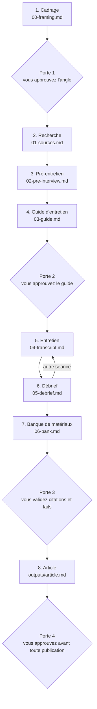

# Readme2

[Français](README.fr.md) · [English](README.md)

[](LICENSE)


Readme2 vous interview sur votre projet, comme le ferait un magazine, puis écrit l'article à partir de vos propres réponses. Le résultat est un README 2.0 : l'histoire, les choix et les chiffres derrière un code qui resterait sinon caché sur GitHub.

## Le problème

Les développeurs aiment construire et détestent écrire.
La partie la plus utile d'un projet reste dans le code, sur GitHub, où peu de gens la lisent.
La page blanche arrête la plupart des gens avant même qu'ils commencent.

## Comment ça marche



1. **Cadrage.** Le skill ne demande que ce qu'il ne peut pas déduire : le projet et ses sources, le public, l'angle. Il écrit le cadrage et attend votre accord.
2. **Recherche.** Avant de poser une question, le skill lit vos sources et écrit une chronologie datée, avec les trous qu'aucun document ne raconte.
3. **Pré-entretien.** Trois à cinq questions : ce que vous attendez, les sujets qui comptent, ce qui est exclu, ce qui doit rester privé.
4. **Guide d'entretien.** Un plan construit sur des faits datés : des blocs allant du plus léger au plus lourd, reliés par des questions de transition. Vous le validez avant l'entretien.
5. **Entretien.** Une question à la fois. Chaque réponse est notée mot pour mot, et une réponse floue est relancée une fois.
6. **Débrief.** Après chaque séance : ce qu'on a appris, la confiance qu'on peut lui accorder, ce que cela change. Chaque point est étiqueté fait, déduction ou opinion.
7. **Banque de matériaux.** Citations exactes, anecdotes, chiffres et positions, chacun en attente de votre validation.
8. **Article.** Écrit uniquement à partir de la banque validée, puis passe de style et contrôle automatique.

## Ce qu'il ne fait jamais

- Il n'invente jamais un fait, un chiffre, une date, un nom ou une citation. Un trou reste marqué `[?]`.
- Il ne prête jamais une raison que vous n'avez pas donnée. Ses propres déductions restent dans le débrief, étiquetées comme telles.
- Il garde vos mots. Les guillemets n'entourent que des mots exacts de la transcription.
- Il ne reprend jamais un sujet que vous avez refusé.
- Il ne publie ni ne montre aucun texte final sans votre validation.

Le dernier contrôle est `scripts/check_article.py`. Lancez-le depuis le dossier du skill avec `python3 scripts/check_article.py interviews/<slug>`. Il rend le code 0 si tout passe, 1 sinon. Il échoue si :

- un `[?]` subsiste dans l'article ;
- une citation d'au moins quatre mots n'apparaît ni dans la transcription, ni dans la banque validée (une traduction passe si la banque la donne à côté de son original) ;
- `06-bank.md` n'est pas marqué `validated: yes` ;
- l'article n'a pas `humanizer: done` dans son en-tête.

## Démarrage rapide

**Claude Code.** Copiez le skill dans votre dossier de skills personnel :

```bash
git clone https://github.com/malikkaraoui/Readme2.git
mkdir -p ~/.claude/skills
cp -R Readme2/skills/readme2-interview ~/.claude/skills/
```

**Application Claude.** Zippez le dossier `skills/readme2-interview`, importez-le, puis activez-le dans les réglages de skills de votre compte claude.ai.

**Utilisation.** Dans une session ouverte sur votre projet, dites :

> Interviewe-moi sur ce projet.

(En anglais : « Interview me about this project. »)

Le skill crée `interviews/<slug>/` dans votre projet et y garde chaque étape. Un entretien peut s'arrêter et reprendre d'une session à l'autre.

## Feuille de route

- **V1** (maintenant) : un entretien écrit qui produit un article.
- **V2** : entretien audio, série d'articles, publications sur les réseaux, podcast dans votre voix synthétisée, vidéo animée.
- **V3** : un hub public où investisseurs, porteurs de projet et développeurs découvrent les projets à travers leur README 2.0.

Source : [`readme_2_0_vision.md`](readme_2_0_vision.md).

## Méthode et sources

La méthode et ses sources sont dans [`skills/readme2-interview/references/`](skills/readme2-interview/references/sources.md).

## Licence

MIT. Voir [LICENSE](LICENSE).
