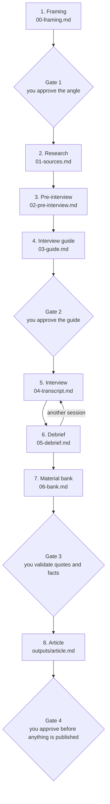

# Readme2

[Français](README.fr.md) · English

[](LICENSE)


Readme2 interviews you about your project, the way a magazine would, then writes the article from your own answers. The result is a README 2.0: the story, the choices and the numbers behind code that would otherwise stay hidden on GitHub.

## The problem

Developers like building things and dislike writing about them.
The most useful part of a project stays in the code, on GitHub, where few people read it.
The blank page stops most people before they start.

## How it works



1. **Framing.** The skill asks only what it cannot infer: the project and its sources, the audience, the angle. It writes the framing and waits for your go.
2. **Research.** Before asking anything, the skill reads your sources and writes a dated timeline, with the gaps that no document records.
3. **Pre-interview.** Three to five questions: what you expect, which topics matter, what is off limits, what must stay private.
4. **Interview guide.** A plan built from dated facts: blocks ordered from light to heavy, with a bridge between them. You validate it before the interview starts.
5. **Interview.** One question at a time. Each answer is recorded verbatim, and a vague answer is pressed once.
6. **Debrief.** After each session: what was learned, how far to trust it, what it changes. Every point is labelled as fact, deduction or opinion.
7. **Material bank.** Exact quotes, stories, numbers and positions, each one waiting for your validation.
8. **Article.** Written only from the validated bank, then a style pass and an automatic check.

## What it never does

- It never invents a fact, a number, a date, a name or a quote. A gap stays marked `[?]`.
- It never puts a reason in your mouth that you did not give. Its own inferences stay in the debrief, labelled as deductions.
- It keeps your words. Quotation marks appear only around exact words from the transcript, or around a translation validated in the bank.
- It never raises a topic you declined.
- It never publishes or shows a final text before your validation.

The last check is `scripts/check_article.py`. Run it from the root of your project, with the full path to the script: `python3 ~/.claude/skills/readme2-interview/scripts/check_article.py interviews/<slug>`. It exits with 0 when everything passes and 1 otherwise. It fails when:

- `[?]` is still in the article;
- a quotation of four words or more appears neither in the transcript nor in the validated bank (a translation passes when the validated bank contains it);
- `06-bank.md` is not marked `validated: yes`;
- the article lacks `humanizer: done` in its frontmatter.

## Quick start

**Claude Code.** Copy the skill into your personal skills folder:

```bash
git clone https://github.com/malikkaraoui/Readme2.git
mkdir -p ~/.claude/skills
cp -R Readme2/skills/readme2-interview ~/.claude/skills/
```

**Claude app.** Zip the `skills/readme2-interview` folder, upload it, then enable it in your claude.ai skill settings.

**Use it.** In a session opened on your project, say:

> Interview me about this project.

(In French: « Interviewe-moi sur ce projet. »)

The skill creates `interviews/<slug>/` in your project and keeps every step there. An interview can stop and resume across sessions.

## Roadmap

- **V1** (now): a written interview that produces one article.
- **V2**: audio interview, article series, social posts, podcast in your own synthesised voice, motion video.
- **V3**: a public hub where investors, project leads and developers discover projects through their README 2.0.

Source: [`readme_2_0_vision.md`](readme_2_0_vision.md).

## Method and sources

The method and its sources are in [`skills/readme2-interview/references/`](skills/readme2-interview/references/sources.md).

## License

MIT. See [LICENSE](LICENSE).
